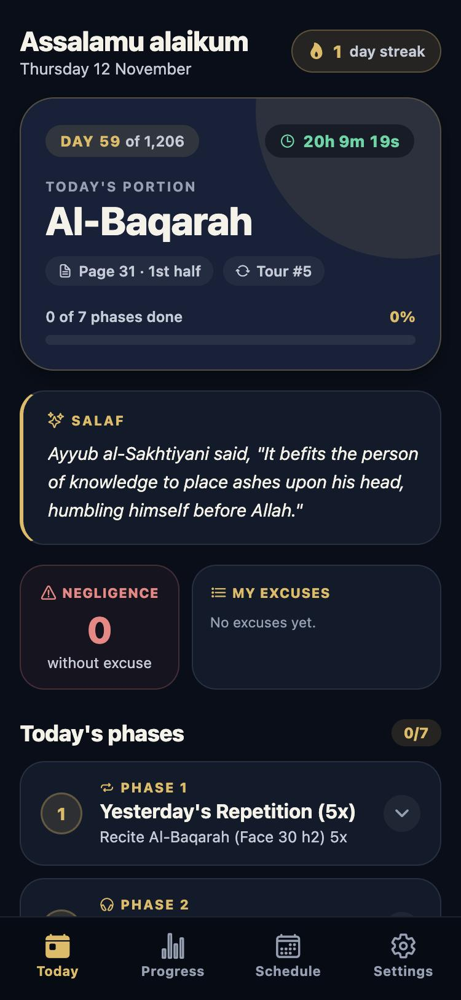
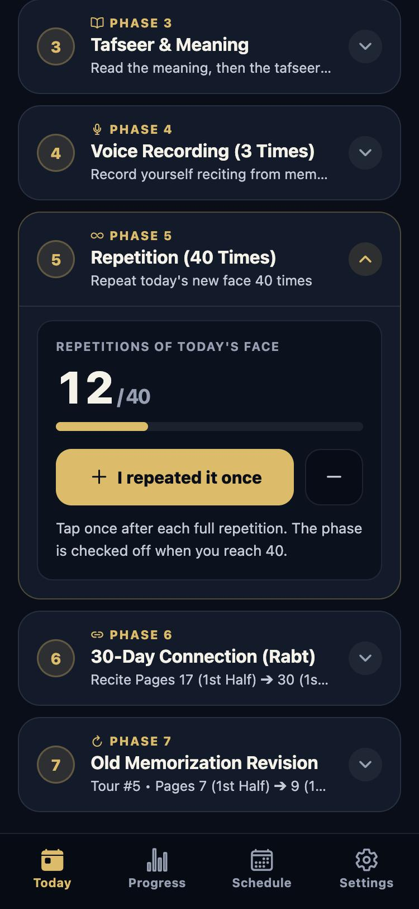
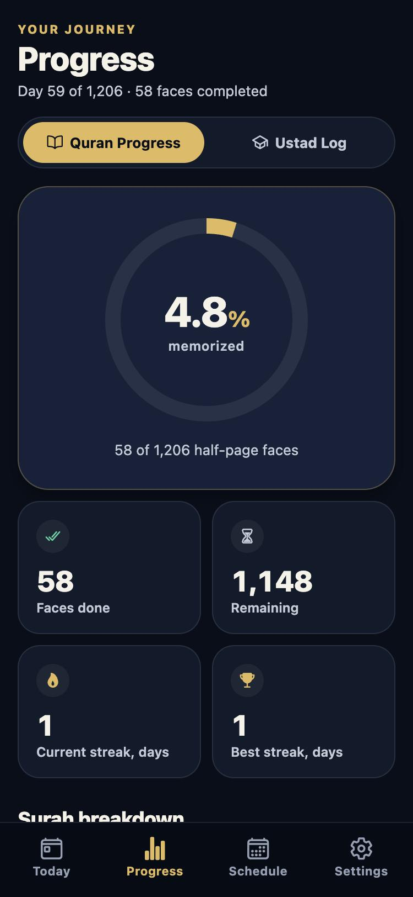
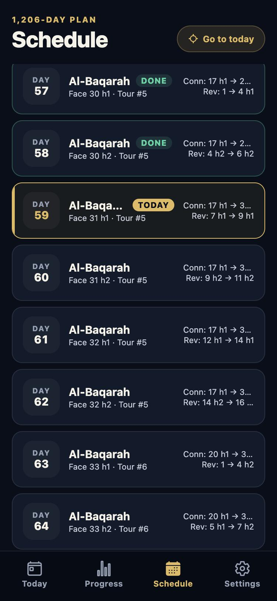

<div align="center">


# Tikrar

**A daily companion for memorizing the Quran with the 1,206-day Tikrar program.**

[](https://github.com/scalerflux/tikrar/actions/workflows/ci.yml)
[](https://github.com/scalerflux/tikrar/releases/latest)
[](LICENSE)


[**Download the latest APK**](https://github.com/scalerflux/tikrar/releases/latest) · [The program guide (PDF)](docs/Tikrar-0.5.pdf) · [Report a problem](https://github.com/scalerflux/tikrar/issues)

</div>

<br />

<p align="center">
  
  &nbsp;
  
  &nbsp;
  
  &nbsp;
  
</p>

## What it is

Tikrar follows the memorization program from Tikrar.net in Madinah. The Quran is split into 1,206 half-pages, called faces. Each day you memorize one new face and revise what came before it. The app tells you what today's portion is, walks you through the day's phases, and keeps track of what you have finished.

The app does not contain the Mus-haf text. You read and memorize from your own printed Madinah Mus-haf.

## The daily routine

Every day has the same seven phases, taken from the program's timetable.

| # | Phase | What you do |
|---|-------|-------------|
| 1 | Yesterday's repetition | Recite yesterday's face 5 times from memory. |
| 2 | Listening | Listen to today's face 3 times while following the Mus-haf. |
| 3 | Tafseer and meaning | Read the meaning and the tafseer of today's face. |
| 4 | Voice recording | Record yourself 3 times from memory, then check the recordings against the Mus-haf. |
| 5 | Repetition | Repeat the new face 40 times. The app counts for you. |
| 6 | Connection | Recite everything from the last 30 days once. Starts on day 3. |
| 7 | Revision | Recite your slice of older memorization. Starts on day 33 and cycles every 6 days. |

A day runs from Fajr to the next Fajr, so work you finish after midnight still counts for the same portion.

## Features

- **Two starting points.** Begin at Al-Fatihah and follow the Mus-haf, or begin at An-Nas and work back. Going backward, the short surahs are kept whole and every surah is still read from its beginning.
- **Audio by ayah.** Pick a reciter, play today's face, and tap any ayah to jump to it.
- **Meaning alongside.** The Hilali and Muhsin Khan translation of today's face, saved on the device after the first load.
- **Voice recorder.** Three takes a day, each saved separately so you can compare them.
- **Progress.** A ring for the whole Quran, a count per surah, current and best streaks, and a 1,206-day heat map.
- **Ustad sessions.** Set your teacher's days and time, get a reminder before class, add the sessions to your calendar, and log what you recited.
- **Honest accountability.** A missed day asks for a reason. Days missed without one are counted.
- **Backup and restore.** Export your progress and settings as a file and import it on another phone.
- **Already memorized some?** Enter the page you have reached and the app starts you from the next face.

## Install on Android

1. Open the [latest release](https://github.com/scalerflux/tikrar/releases/latest) in your phone's browser.
2. Tap the `.apk` file under Assets.
3. Android's installer opens and asks you to confirm. If it asks, allow your browser to install unknown apps.

No Play Store, Expo Go or account is needed.

## Run it locally

You need Node.js 20.19 or newer and npm, plus Expo Go or an Android emulator.

```bash
npm install
```

```bash
npm start
```

Checks:

```bash
npm run typecheck
```

```bash
npm test
```

## Build the APK

**On GitHub.** Open **Actions → Android APK → Run workflow**, keep the branch as `main`, and enter a version such as `1.1.0`. The run builds the APK with Gradle and attaches it to a release named after the version. It needs no Expo account and no secrets. Running it again for the same version replaces the APK on that release.

**On your machine.** With the Android SDK and Java 17 installed:

```bash
npx expo prebuild --platform android --clean
```

```bash
cd android && ./gradlew assembleRelease
```

The APK is written to `android/app/build/outputs/apk/release/`.

Every push to `main` also runs the typecheck and tests through [`ci.yml`](.github/workflows/ci.yml).

## Data and privacy

Your schedule, progress, excuses, recordings and settings stay on your phone. There is no account and no server of ours. The app goes online for two things only: streaming recitation audio, and fetching the translation of a page the first time you open it.

## Project structure

```text
app/           Screens and onboarding (Expo Router)
components/    Today, schedule and progress building blocks
constants/     Colours, spacing and other design tokens
data/          The 1,206-day timetable, surah list and daily reminders
database/      SQLite storage with an AsyncStorage fallback
services/      Audio, recording, backup, reminders, calendar and translation
utils/         Schedule maths, face parsing and validation
__tests__/     Unit tests for the schedule and core behaviour
docs/          The program guide and screenshots
```

Built with Expo, React Native and TypeScript.

## Credits

The memorization method, preconditions and timetable belong to the Tikrar program of Madinah. See [www.Tikrar.net](https://www.tikrar.net) or write to Info@Tikrar.net. The [program guide](docs/Tikrar-0.5.pdf) in this repository is theirs. The app's timetable was checked against it row by row.

## License

The source code is released under the [MIT License](LICENSE). Quran recitations, translations, the program guide and other third-party material remain under their own licenses and terms.
